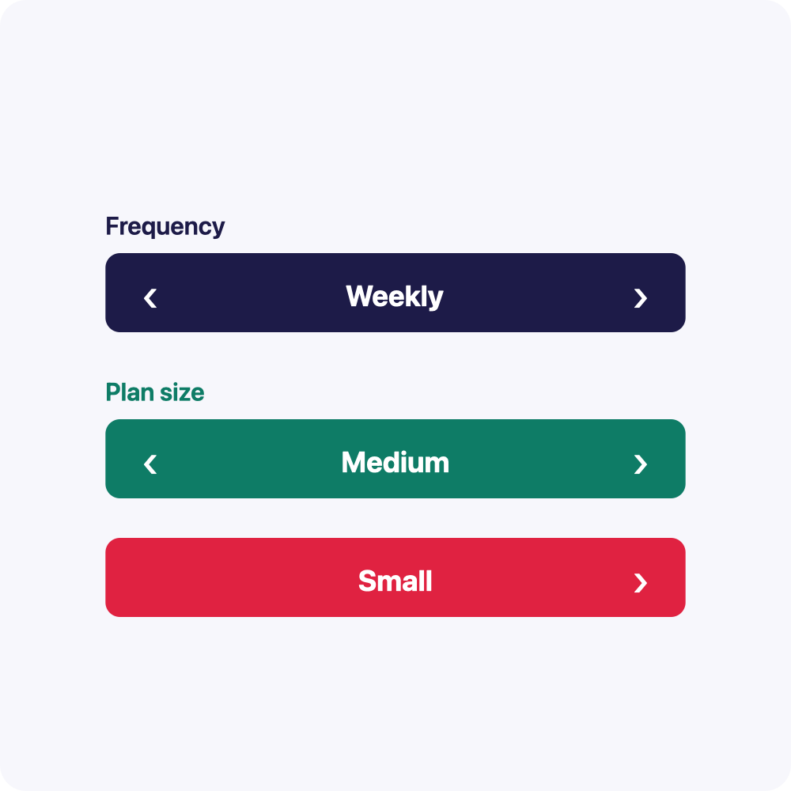

# @acertijosapps/react-native-select-horizontal

A sleek, mobile-first alternative to the traditional dropdown for React Native.
Instead of opening a menu that covers the screen, users step through the options
inline with left/right arrows — a faster, one-handed, thumb-friendly pattern
built for phones. Dependency-free and fully themeable, so it adopts your design
system: colors, sizes, fonts and even custom arrow icons.

**Zero runtime dependencies.** Only `react` and `react-native` as peers.

<p align="center">
  
</p>

## Install

```bash
yarn add @acertijosapps/react-native-select-horizontal
# or
npm install @acertijosapps/react-native-select-horizontal
```

## Usage

```tsx
import SelectHorizontal from '@acertijosapps/react-native-select-horizontal';

const data = [
    { id: 1, label: 'Daily' },
    { id: 2, label: 'Weekly' },
    { id: 3, label: 'Monthly' },
];

export function Example() {
    return (
        <SelectHorizontal
            labelText="Frequency"
            data={data}
            startPosition={0}
            onChange={(position, item) => console.log(position, item.label)}
        />
    );
}
```

### Theming

Every dimension and color is a prop with a constant default, so the component
adopts your design system:

```tsx
<SelectHorizontal
    data={data}
    fontSize={18}
    iconSize={25}
    borderRadius={9}
    primaryColor="#1D1B48"
    accentColor="#FFFFFF"
    iconColor="#FFFFFF"
    fontFamily="Sora"
    labelFontWeight="400"
    valueFontWeight="600"
/>
```

Defaults: `fontSize` 18, `iconSize` 25, `borderRadius` 9, `primaryColor`
`#1D1B48`, `accentColor` `#FFFFFF`. They are also exported if you want to
reference them:

```tsx
import {
    DEFAULT_ACCENT_COLOR,
    DEFAULT_BORDER_RADIUS,
    DEFAULT_FONT_SIZE,
    DEFAULT_ICON_SIZE,
    DEFAULT_PRIMARY_COLOR,
} from '@acertijosapps/react-native-select-horizontal';
```

### Custom arrows

By default arrows render as text chevrons (`‹` `›`). Pass any component through
the render props to bring your own icons (an SVG, an icon font, an emoji…):

```tsx
<SelectHorizontal
    data={data}
    renderLeftIcon={({ size, color }) => (
        <MyChevronLeft
            size={size}
            color={color}
        />
    )}
    renderRightIcon={({ size, color }) => (
        <MyChevronRight
            size={size}
            color={color}
        />
    )}
/>
```

## Props

| Prop                    | Type                                          | Default     | Description                                   |
| ----------------------- | --------------------------------------------- | ----------- | --------------------------------------------- |
| `data`                  | `{ id: number \| string; label: string }[]`   | —           | **Required.** Options to page through.        |
| `startPosition`         | `number`                                      | `0`         | Index selected on mount.                      |
| `labelText`             | `string`                                      | `''`        | Label above the bar. Hidden when empty.       |
| `onChange`              | `(position: number, item) => void`            | —           | Fired when the selection changes.             |
| `fontSize`              | `number`                                      | `18`        | Label and value font size.                    |
| `iconSize`              | `number`                                      | `25`        | Arrow icon size.                              |
| `borderRadius`          | `number`                                      | `9`         | Corner radius of the selector bar.            |
| `primaryColor`          | `string`                                      | `#1D1B48`   | Bar background and label color.               |
| `accentColor`           | `string`                                      | `#FFFFFF`   | Value and arrow color.                        |
| `iconColor`             | `string`                                      | `accentColor` | Overrides `accentColor` for arrows only.    |
| `fontFamily`            | `string`                                      | —           | Font family for label and value.              |
| `labelFontWeight`       | `TextStyle['fontWeight']`                     | normal      | Weight of the label.                          |
| `valueFontWeight`       | `TextStyle['fontWeight']`                     | bold        | Weight of the selected value.                 |
| `renderLeftIcon`        | `(p: ArrowRenderProps) => ReactNode`          | text `‹`    | Custom left arrow.                            |
| `renderRightIcon`       | `(p: ArrowRenderProps) => ReactNode`          | text `›`    | Custom right arrow.                           |
| `contentContainerStyle` | `ViewStyle`                                   | —           | Outer wrapper style.                          |
| `style`                 | `ViewStyle`                                   | —           | Selector bar style.                           |
| `labelStyle`            | `TextStyle`                                   | —           | Extra label style.                            |
| `valueStyle`            | `TextStyle`                                   | —           | Extra value style.                            |
| `iconStyle`             | `TextStyle`                                   | —           | Style for the default chevrons (ignored with custom render). |
| `testID`                | `string`                                      | —           | testID for the root view. Arrows get `${testID}-left` / `${testID}-right` (`btnLeft` / `btnRight` without it). |

## Example

A runnable Expo app lives in [`example/`](example). It imports the component
straight from `src` (via `babel-plugin-module-resolver` + a Metro
`watchFolders` config), so edits to the library hot-reload in the demo.

```bash
cd example
yarn install
yarn ios      # or: yarn android / yarn web
```

The demo shows the defaults, a custom theme, custom arrow icons, and a label-less
variant.

## License

MIT
